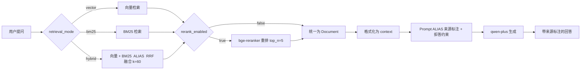

# 服装电商智能客服 RAG

基于检索增强生成（RAG）的服装电商客服问答系统。核心解决一个问题：**让模型回答时有据可依，没依据时明确说不**。

在 26 篇领域文档、57 个文本块、39 道评测题上，混合检索把正确答案的 top-5 命中率做到 100%，重排把 top-1 命中率从 82.1% 提升到 92.3%，代价是每题多约 7.6 秒（CPU 推理）。

## 核心能力

| 能力 | 说明 |
|---|---|
| 三路检索 | `vector` / `bm25` / `hybrid` 三种模式可切换，hybrid 用 RRF 融合 |
| 交叉编码重排 | bge-reranker-base 对粗排候选做 query-passage 逐字打分 |
| 来源标注 | 每条结论后附 `[来源：文件名]`，可追溯到原文 |
| 无依据拒答 | 参考资料不含答案时只回固定话术，不用常识补充 |
| 离线可用 | 模型走本地缓存，不依赖 HuggingFace 连通性 |

## 架构



`rag.py` 的调用链：`RunnableLambda(_retrieve)` → `format_document` → `ChatPromptTemplate` → `ChatTongyi` → `StrOutputParser`，外层用 `RunnableWithMessageHistory` 挂对话历史。

**关键设计点**：所有分支（含重排）在 `_retrieve` 内部统一成 `list[Document]` 再返回，下游 `format_document` 完全不感知检索模式。这样加新检索器不用动 chain。

## 目录结构

```
├── rag.py                  # 主链路：RagService，检索分流 + 重排 + 生成
├── hybrid_retriever.py     # 混合检索：向量/BM25/RRF 三路
├── keyword_retriever.py    # BM25 关键词检索
├── vector_stores.py        # Chroma 向量库封装
├── reranker.py             # RerankerService：懒加载 + 批量打分 + 二级排序
├── knowledge_base.py       # 入库（切块、去重、写入 Chroma）
├── config_data.py          # 全部配置集中管理
├── app_qa.py               # Streamlit 聊天界面
├── eval_retrieval.py       # 检索层评测：hit_rate@1/@5、MRR、分组对比
├── debug_q27.py            # 单题失败归因脚本
├── ingest_data.py          # 批量入库脚本
├── data/                   # 26 篇知识文档 + 39 题评测集
├── day5_rerank_report_1117.md   # 重排接入的完整评测报告
└── baseline_report_0903.md      # 项目初期的数据摸底报告
```

## 快速开始

### 1. 环境

```bash
pip install -r requirements.txt
```

> `FlagEmbedding` 在部分镜像源缺失，可用阿里云源：
> `pip install FlagEmbedding -i https://mirrors.aliyun.com/pypi/simple/`

### 2. 配置 `.env`

```ini
DASHSCOPE_API_KEY=sk-xxxxxxxx
# 可选：指向本地 reranker 快照，避免加载时联网校验
BGE_RERANKER_PATH=C:/Users/xxx/.cache/huggingface/hub/models--BAAI--bge-reranker-base/snapshots/<hash>
```

不配 `BGE_RERANKER_PATH` 时，transformers 会尝试连接 HuggingFace 拉取仓库信息，国内网络下会超时。首次下载模型需要：

```bash
set HF_ENDPOINT=https://hf-mirror.com
set HF_HUB_DISABLE_XET=1
```

### 3. 入库

```bash
python ingest_data.py
```

预期写入 26 篇文档、57 个块。块 ID 用内容 MD5 前 8 位生成，重复入库不会产生重复块。

### 4. 启动

```bash
streamlit run app_qa.py
```

### 5. 跑评测

```bash
python eval_retrieval.py
```

## 配置说明

全部集中在 `config_data.py`：

| 配置 | 默认值 | 说明 |
|---|---|---|
| `retrieval_mode` | `hybrid` | `vector` / `bm25` / `hybrid` |
| `retrieval_top_k` | 5 | 最终喂给模型的块数 |
| `rerank_enabled` | `False` | 重排总开关 |
| `rerank_candidate_k` | 20 | 送进重排的粗排候选数 |
| `rerank_top_n` | 5 | 重排后保留数 |
| `chunk_size` / `chunk_overlap` | 400 / 60 | 切块参数 |
| `chat_model_name` | `qwen-plus` | 生成模型 |

**重排默认关闭**：CPU 下每题多约 7.6 秒，作为可选增强。想体验效果把 `rerank_enabled` 改成 `True`，首次提问会等约 30 秒加载模型。

## 关键设计取舍

**为什么 hybrid 用 RRF 而不是分数加权？**
向量检索返回的是余弦相似度，而bm25返回的是无界词频分数，两者的量纲和分布完全不同，加权就需要进行归一，但归一对分布极为敏感，换数据集就失效，而rrf只用排名不用分数，对异构分数天然鲁棒，不需要调权重    
**k=60 从哪来？**
k=60是rrf原论文的经验值，这个k越大，靠后名次的贡献被压平，融合的越民主，而k越小，头部名次的优势越大，60是一个工程常用值

**为什么用 cross-encoder 重排，而不是再训一个更好的 bi-encoder？**
cross-encoder把query和passage拼在一起送进模型做全交叉注意力，精度显著高于双塔式bi-encoder，但是缺点在于无法预计算，每个候选都要跑一次前向，成本o(n),所以必须两阶段，粗排召回二十条，精排召回五条

**为什么重排默认关闭？**
CPU 下单题 7.58 秒，对客服场景的交互延迟不可接受。它作为可选增强保留：`rerank_enabled=True` 时打开，用于验证效果或离线场景。真上生产需要 GPU 或更小的 reranker。

## 评测结果

**方法**：39 道题覆盖全部 26 篇文档，按难度分三档——`lexical`（15 题，关键词可命中）、`semantic`（8 题，口语化改写）、`distractor`（16 题，专为制造混淆设计，含跨文档冲突内容）。对照「hybrid 不重排取 top5」与「hybrid 召回 20 → 重排取 top5」。

| 指标 | 不重排 | 重排 | 变化 |
|---|---|---|---|
| hit_rate@5 | 100% | 100% | — |
| hit_rate@1 | 82.1% (32/39) | **92.3%** (36/39) | +10.2pp |
| MRR | 0.897 | **0.949** | +0.052 |
| 平均命中位置 | 1.31 | **1.05** | -0.26 |
| 平均耗时/题 | 0.18s | 7.58s | ×42 |

**结论**：在 57 块的库上，hybrid + RRF 已能把正确答案稳定送进 top5，但 top1 约有 1/5 排错；重排把这部分纠正回来，代价是数量级的延迟增长。

### 亮点：重排捞回掉出 top5 的答案

`q29 真丝衣服自己在家洗要注意什么`：粗排把正确答案排到**第 6 名**（已掉出 top5），重排一把拉回**第 2 名**。向量相似度在长句、口语化 query 上会失准，cross-encoder 逐字比对 query-passage 能纠回来。

### 失败案例：重排反而把正确答案挤出 top5

`q27 防晒衣应该怎么洗`：粗排第 3 名，重排后掉出 top5。

知识库里两篇文档对这个问题的结论**互相矛盾**：
- `夏季穿搭.txt`：防晒衣有防晒涂层，**禁用柔顺剂**（正确）
- `洗涤养护.txt`：轻薄化纤衣物洗涤**可加柔顺剂**（对普通化纤正确，对涂层错误）

重排打分：错误段 0.9761，正确段 0.7991。原因有三层——错误段字面覆盖了 query 的每个词、正确段的涂层信息被切块埋在中后段、cross-encoder 只判相关性不做事实核查。

**这条失败案例的结论**：重排能纠正"排得不够靠前"，但不能纠正"文档本身互相矛盾"。这是数据质量问题，不是模型问题。它同时说明为什么需要人工维护知识库的一致性。

## 已知局限

- **无答案级评测**。当前只评了检索命中位置，没有评答案忠实度、相关性。简历/文档中如实写"检索评测 39 题，答案级评测未做"。
- **延迟**。CPU 下重排 7.6 秒/题。缓解方向：GPU 推理、换 tiny 版 reranker、仅在粗排 top1 分数不显著时触发重排。
- **只支持 .txt**。PDF/Word 解析未实现。
- **单用户会话**。`session_config` 写死 `user_001`，历史文件无上限。
- **知识库存在同题冲突**（见 q27），未做数据源一致性治理。
- **消融实验样本极小**。对「来源标注」做过 2×2 对照（有无示例 × 重排开关），四种组合输出逐字相同，说明该用例上示例与重排都没有可观测贡献，真正的变量是"必须标注来源"这条规则本身。n=1，不能推广。

## 踩坑记录

1. **模型已缓存却仍联网超时**：transformers 加载时会调 `list_repo_templates` 列仓库文件。解法是 `HF_HUB_OFFLINE=1` 或直接把 `BGE_RERANKER_PATH` 指向本地快照目录。
2. **`retrieval_top_k` 配了不生效**：hybrid 分支 `rrf_merge` 后漏了 `[:limit]`，两路各 5 条合并成 9 条全喂给模型。发现方式是"输出 9 个文档但配置写 5"这个数字对不上。
3. **`from_messages` 的 role 不能自定义**：元组是 `(role, content)`，写成 `("1.system", ...)` 会直接报错。编号属于内容，不属于 role。
4. **重排必须用二级排序**：rerank 分数相同时按 `original_score` 兜底，否则同分块的顺序不稳定，评测结果无法复现。

## 后续计划

- [ ] 答案级评测（RAGAS）：faithfulness / answer_relevancy / context_precision
- [ ] `retrieval_top_k` 按文献支撑度动态调整（5 → 8，减少 q27 这类"正确块被挤出去"）
- [ ] 知识库一致性治理：同一问题多文档冲突时标注权威来源
- [ ] PDF/Word 解析、多用户会话隔离
- [ ] 检索层加缓存、重排按需触发

## 环境

Python 3.11 / Windows / CPU（无 GPU）

```
langchain-core 1.5.6        langchain-community 0.4.2    chromadb 1.5.9
dashscope 1.26.7            FlagEmbedding 1.4.2          transformers 5.15.0
torch 2.13.0+cpu            jieba 0.42.1                 rank-bm25 0.2.2
streamlit 1.62.0            python-dotenv 1.2.3
```
